# MITRE ATT&CK® Playbooks (ภาษาไทย)

คู่มือปฏิบัติการสำหรับทีม SOC / Incident Response / Detection Engineering ที่อธิบายทุก Tactic ของ MITRE ATT&CK v20.0
ใน 3 มุม:

| มุม | คำถามที่ตอบ |
|---|---|
| **วิธีการทำงาน** | ผู้โจมตีทำขั้นตอนนี้อย่างไร ใช้เครื่องมือหรือกลไกอะไร ทิ้งร่องรอยอะไรไว้ |
| **วิธีตรวจสอบ** | ต้องเก็บ Log อะไร ดูสัญญาณอะไร และ query KQL สำหรับ Microsoft Sentinel / Defender XDR |
| **วิธีรับมือ** | ขั้นตอน triage, containment, eradication, recovery และมาตรการป้องกันระยะยาว (Mitigations) |

> เอกสารชุดนี้เป็นงานชุมชน ไม่ได้มีส่วนเกี่ยวข้องหรือได้รับการรับรองจาก MITRE
> ATT&CK® is a registered trademark of The MITRE Corporation.
> KQL ทุกชุดเป็นจุดเริ่มต้นสำหรับ hunting — ต้องทดสอบกับข้อมูลจริงใน tenant ของคุณและปรับ threshold ก่อนตั้งเป็น analytics rule

## เริ่มอ่านจากตรงไหน

1. [`docs/00-how-to-use.md`](docs/00-how-to-use.md) — วิธีใช้คู่มือ, IR lifecycle, ระดับความรุนแรง, Log ที่ต้องเปิดก่อน และข้อตกลงของ KQL
2. เลือก Domain แล้วอ่านตามลำดับ Kill Chain:

### Enterprise (15 Tactics)

```mermaid
flowchart LR
  A[01 Reconnaissance] --> B[02 Resource Development] --> C[03 Initial Access] --> D[04 Execution]
  D --> E[05 Persistence] --> F[06 Privilege Escalation] --> G[07 Stealth] --> H[08 Defense Impairment]
  H --> I[09 Credential Access] --> J[10 Discovery] --> K[11 Lateral Movement]
  K --> L[12 Collection] --> M[13 Command and Control] --> N[14 Exfiltration] --> O[15 Impact]
```

| # | Tactic | ไฟล์ | Technique ที่เจาะลึก |
|---|---|---|---|
| 01 | TA0043 Reconnaissance | [enterprise/01-reconnaissance.md](enterprise/01-reconnaissance.md) | T1595, T1589, T1598, T1593 |
| 02 | TA0042 Resource Development | [enterprise/02-resource-development.md](enterprise/02-resource-development.md) | T1583/T1584, T1588, T1585/T1586, T1608 |
| 03 | TA0001 Initial Access | [enterprise/03-initial-access.md](enterprise/03-initial-access.md) | T1566, T1190, T1133, T1078, T1195, T1199 |
| 04 | TA0002 Execution | [enterprise/04-execution.md](enterprise/04-execution.md) | T1059, T1204, T1047, T1569, T1053, T1698/T1699 |
| 05 | TA0003 Persistence | [enterprise/05-persistence.md](enterprise/05-persistence.md) | T1547, T1543, T1098, T1136, T1505.003, T1556 |
| 06 | TA0004 Privilege Escalation | [enterprise/06-privilege-escalation.md](enterprise/06-privilege-escalation.md) | T1548, T1134, T1068, T1484 |
| 07 | TA0005 Stealth | [enterprise/07-stealth.md](enterprise/07-stealth.md) | T1218, T1036, T1027, T1055, T1070, T1564 |
| 08 | TA0112 Defense Impairment | [enterprise/08-defense-impairment.md](enterprise/08-defense-impairment.md) | T1685, T1686, T1553, T1688 |
| 09 | TA0006 Credential Access | [enterprise/09-credential-access.md](enterprise/09-credential-access.md) | T1003, T1558, T1110, T1621, T1539/T1557, T1552 |
| 10 | TA0007 Discovery | [enterprise/10-discovery.md](enterprise/10-discovery.md) | T1087/T1069, T1046, T1518, T1580 |
| 11 | TA0008 Lateral Movement | [enterprise/11-lateral-movement.md](enterprise/11-lateral-movement.md) | T1021, T1550, T1570 |
| 12 | TA0009 Collection | [enterprise/12-collection.md](enterprise/12-collection.md) | T1560, T1114, T1213, T1530 |
| 13 | TA0011 Command and Control | [enterprise/13-command-and-control.md](enterprise/13-command-and-control.md) | T1071, T1219, T1572/T1090, T1105 |
| 14 | TA0010 Exfiltration | [enterprise/14-exfiltration.md](enterprise/14-exfiltration.md) | T1567, T1041/T1048, T1537 |
| 15 | TA0040 Impact | [enterprise/15-impact.md](enterprise/15-impact.md) | T1490, T1486, T1489, T1485, T1496 |

### Mobile และ ICS / OT

| Domain | ไฟล์ | ครอบคลุม |
|---|---|---|
| Mobile (Android / iOS) | [mobile/README.md](mobile/README.md) | 12 Tactics (TA0027–TA0041) |
| ICS / OT | [ics/README.md](ics/README.md) | 12 Tactics (TA0100–TA0111) + ICS Assets A0001–A0018 |

## โครงสร้างของแต่ละ Tactic

ทุกไฟล์ใช้รูปแบบเดียวกัน (ดู [`templates/tactic-template.md`](templates/tactic-template.md)):

1. **เป้าหมายของผู้โจมตี** — ทำไมผู้โจมตีต้องผ่านขั้นนี้
2. **ลำดับการทำงาน** — ขั้นตอนที่มักเกิดขึ้นจริง
3. **Log ที่ต้องมี** — Data source และตาราง Sentinel / Defender XDR
4. **Technique เจาะลึก** — แต่ละข้อมี วิธีทำงาน → สัญญาณ → KQL → วิธีรับมือ → ป้องกันระยะยาว → False positive ที่พบบ่อย
5. **Checklist ตอบสนองระดับ Tactic** — ใช้ได้ทันทีเมื่อพบสัญญาณใดๆ ในขั้นนี้

## ใช้ร่วมกับ

- เว็บไซต์ Mind Map / Matrix / ฐานข้อมูล 935 TTPs: [MITRE ATT&CK Mind Map Studio](https://github.com/Mr-Green013/AIAgentsforITOps/tree/feature/mitre-attack-site/mitre-attack-site)
- [MITRE ATT&CK](https://attack.mitre.org/) — แหล่งข้อมูลทางการ ตรวจสอบรายละเอียดทุก Technique ก่อนอ้างอิง
- [ATT&CK Navigator](https://mitre-attack.github.io/attack-navigator/) — ทำ coverage heatmap จาก Technique ที่มี detection แล้ว

## การมีส่วนร่วม

เพิ่ม Technique หรือ query ใหม่โดยใช้รูปแบบใน `templates/` ทุก query ที่เพิ่มควรระบุ: ตารางที่ใช้, สิ่งที่ต้องปรับ (threshold, allowlist) และ false positive ที่รู้จัก
