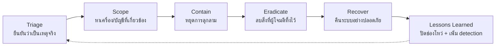

# วิธีใช้คู่มือ

## 1. ใช้คู่มือนี้เมื่อไร

| สถานการณ์ | ใช้ส่วนไหน |
|---|---|
| Alert ขึ้นและรู้ Technique ID แล้ว | ไปที่ไฟล์ Tactic นั้น → หัวข้อ Technique → **วิธีรับมือ** |
| ทำ Threat Hunting | ใช้ **KQL** ของแต่ละ Technique เป็นจุดเริ่มต้น |
| ออกแบบ Detection / ตรวจ coverage | ใช้ตาราง **Log ที่ต้องมี** + **สัญญาณ** เพื่อหาช่องว่าง |
| ซ้อม Tabletop / Purple Team | ใช้ **ลำดับการทำงาน** ของแต่ละ Tactic เป็น scenario |

## 2. Incident Response Lifecycle ที่ใช้ในคู่มือ

ขั้นตอน "วิธีรับมือ" ทุกข้อเรียงตามวงจรนี้ (สอดคล้องกับ NIST SP 800-61 และ NIST CSF 2.0 functions Detect / Respond / Recover):

| ขั้น | สิ่งที่ต้องทำเสมอ |
|---|---|
| **Triage** | ยืนยัน true/false positive, จดเวลา (UTC), ระบุผู้ใช้/เครื่อง/IP, เปิด ticket พร้อม Technique ID |
| **Scope** | ค้นหา IOC เดียวกัน (hash, IP, domain, command line) ทั่วทั้งองค์กรย้อนหลังอย่างน้อย 30 วัน |
| **Contain** | Isolate เครื่อง (MDE: *Isolate device*), revoke session / reset password, block IOC — **เก็บหลักฐานก่อนถ้าทำได้** |
| **Eradicate** | ลบ persistence ทุกจุด, ลบบัญชี/กุญแจที่ผู้โจมตีสร้าง, patch ช่องทางเข้า |
| **Recover** | คืนระบบจาก backup ที่ตรวจแล้วว่าสะอาด, เฝ้าระวังเข้มข้นต่อ 14–30 วัน |
| **Lessons Learned** | เพิ่ม/ปรับ detection, อัปเดต playbook, รายงานผู้บริหาร |

### การเก็บหลักฐาน (ก่อน Contain ถ้าเวลาเอื้อ)

1. MDE: *Collect investigation package* และ *Run antivirus scan*
2. Memory dump ถ้าสงสัย in-memory malware (ก่อนรีบูต)
3. Export Log ที่เกี่ยวข้องจาก Sentinel ช่วงเวลาเกิดเหตุ ±24 ชม.
4. บันทึก chain of custody: ใคร เก็บอะไร เมื่อไร hash ของไฟล์หลักฐาน

## 3. ระดับความรุนแรง (Severity)

| ระดับ | เกณฑ์ | เวลาเริ่มตอบสนอง (แนะนำ) |
|---|---|---|
| **Critical** | Domain Admin / Global Admin ถูกยึด, ransomware เริ่มเข้ารหัส, ลบ backup, ระบบ OT ถูกสั่งงาน | ทันที (≤15 นาที) |
| **High** | Credential dumping, lateral movement, C2 ที่ยืนยันแล้ว, ข้อมูลรั่วไหล | ≤1 ชม. |
| **Medium** | Execution / persistence บนเครื่องเดียวที่ยังไม่ขยายผล, phishing ที่มีคนคลิก | ≤4 ชม. |
| **Low** | Reconnaissance, scan จากภายนอก, phishing ที่ถูกบล็อก | วันทำการถัดไป |

ยกระดับทันทีเมื่อพบสัญญาณจากหลาย Tactic บนเครื่องหรือบัญชีเดียวกันภายใน 24 ชม.

## 4. Log ที่ต้องเปิดก่อนใช้ query

| แหล่งข้อมูล | ตาราง | ใช้ใน Tactic |
|---|---|---|
| Microsoft Defender for Endpoint | `DeviceProcessEvents`, `DeviceNetworkEvents`, `DeviceFileEvents`, `DeviceRegistryEvents`, `DeviceEvents`, `DeviceLogonEvents`, `DeviceImageLoadEvents`, `DeviceInfo` | 03–15 |
| Microsoft Defender for Office 365 | `EmailEvents`, `EmailAttachmentInfo`, `EmailUrlInfo`, `UrlClickEvents` | 01, 03 |
| Microsoft Defender for Identity | `IdentityLogonEvents`, `IdentityQueryEvents`, `IdentityDirectoryEvents` | 09–11 |
| Defender XDR alerts | `AlertInfo`, `AlertEvidence` | ทุก Tactic |
| Microsoft Entra ID | `SigninLogs`, `AADNonInteractiveUserSignInLogs`, `AuditLogs` | 01, 03, 05, 09 |
| Microsoft 365 | `OfficeActivity`, `CloudAppEvents` | 05, 12, 14 |
| Windows Security Events (AMA) | `SecurityEvent` (ควรใช้ระดับ *Common* หรือ *All*) | 05, 06, 08, 09, 11 |
| Windows Event (System / PowerShell Operational) | `Event` | 04, 08 |
| Azure | `AzureActivity`, `StorageBlobLogs` | 08, 12, 14, 15 |
| AWS | `AWSCloudTrail` (เปิด data events ของ S3 ถ้าต้องการตรวจ T1530) | 08, 10, 12, 14, 15 |
| Firewall / Proxy (CEF) | `CommonSecurityLog` | 01, 13, 14, ICS |
| DNS Server | `DnsEvents` | 13 |
| IIS | `W3CIISLog` | 01, 03 |
| Linux / ESXi | `Syslog` | 15 |
| Threat Intelligence | `ThreatIntelligenceIndicator` (tenant ใหม่อาจเป็น `ThreatIntelIndicators`) | 02, 13 |
| Defender for IoT | `SecurityAlert` | ICS |

### Windows Audit Policy ขั้นต่ำ

- Process Creation (4688) **พร้อม command line** — GPO: *Include command line in process creation events*
- PowerShell Script Block Logging (4104) และ Module Logging (4103)
- Kerberos Service Ticket Operations (4769), Kerberos Authentication Service (4768)
- Directory Service Access (4662) บน Domain Controller พร้อม SACL สำหรับ replication rights
- Directory Service Changes (5136), Security Group Management (4728/4732/4756), User Account Management (4720)
- Security State Change / Audit Log Cleared (1102)

## 5. ข้อตกลงของ KQL ในคู่มือนี้

- **ตาราง Defender XDR** (`Device*`, `Email*`, `Identity*`, `UrlClickEvents`, `Alert*`) ใช้คอลัมน์เวลา **`Timestamp`** ตามที่ใช้ใน Advanced Hunting
  ถ้ารันใน Sentinel ผ่าน Defender XDR connector ให้เปลี่ยน `Timestamp` เป็น **`TimeGenerated`**
- **ตารางอื่น** (`SigninLogs`, `SecurityEvent`, `OfficeActivity` ฯลฯ) มีเฉพาะใน Sentinel / Log Analytics และใช้ `TimeGenerated`
- ทุก query กำหนดช่วงเวลาสั้น (`ago(1d)` หรือ `ago(7d)`) เพื่อประหยัด cost — ขยายเมื่อทำ scoping
- ค่าที่ต้องปรับตามองค์กรเขียนไว้ใน `let` ด้านบนของ query หรือระบุใน **สิ่งที่ต้องปรับ**
- ก่อนตั้งเป็น Analytics Rule: รันย้อนหลัง 14–30 วัน, นับจำนวนผลลัพธ์ต่อวัน, ทำ allowlist ของ false positive แล้วค่อยเปิด

## 6. แผนที่ Mitigation ที่อ้างถึงบ่อย

| รหัส | ชื่อ | ตัวอย่างการทำจริง |
|---|---|---|
| M1032 | Multi-factor Authentication | Phishing-resistant MFA (FIDO2 / Windows Hello / Passkey) สำหรับ admin ทุกคน |
| M1026 | Privileged Account Management | Tiered admin model, PIM, แยกบัญชี admin กับบัญชีใช้งานปกติ |
| M1030 | Network Segmentation | ห้าม workstation-to-workstation SMB/RDP/WinRM, แยก OT ด้วย DMZ |
| M1038 | Execution Prevention | WDAC / AppLocker, ASR rules |
| M1040 | Behavior Prevention on Endpoint | EDR ในโหมด Block, ASR rules |
| M1043 | Credential Access Protection | Credential Guard, LSA Protection (RunAsPPL) |
| M1047 | Audit | เปิด audit policy และส่ง Log เข้า SIEM แบบ real-time |
| M1053 | Data Backup | Immutable / offline backup ตามกฎ 3-2-1-1-0 แยกบัญชี admin |
| M1017 | User Training | Phishing simulation, รายงานอีเมลน่าสงสัย |
| M1051 | Update Software | แพตช์ระบบที่เปิดสู่อินเทอร์เน็ตภายใน SLA ที่กำหนด (เช่น KEV ≤ 7 วัน) |
