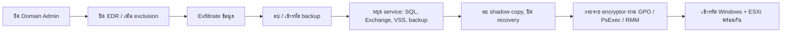

# 15. Impact (TA0040)

## เป้าหมายของผู้โจมตี

ทำให้ธุรกิจหยุดหรือเสียหาย: เข้ารหัสไฟล์เรียกค่าไถ่, ทำลายข้อมูล (wiper), ลบ backup, หยุด service, ลบ resource ในคลาวด์, ใช้ทรัพยากรขุดคริปโต หรือขโมยเงินโดยตรง
เมื่อถึงขั้นนี้ การตอบสนองคือ **หยุดการลุกลามให้เร็วที่สุด** และ **ปกป้อง backup** — ตามด้วยการกู้คืน

## ลำดับการทำงานของ ransomware ที่พบบ่อย



## Log ที่ต้องมี

| สัญญาณ | ตาราง |
|---|---|
| คำสั่งลบ shadow copy / หยุด service | `DeviceProcessEvents` |
| การ rename/แก้ไขไฟล์จำนวนมาก | `DeviceFileEvents` |
| ESXi | `Syslog` |
| ลบ resource ในคลาวด์ | `AzureActivity`, `AWSCloudTrail` |
| Alert ของ Defender | `AlertInfo` (Ransomware, Attack disruption) |

---

## T1490 Inhibit System Recovery

**วิธีทำงาน** — ลบ Volume Shadow Copy, ลบ backup catalog, ปิด Windows Recovery เพื่อไม่ให้กู้ไฟล์เองได้ — **เป็นสัญญาณที่แม่นยำที่สุดว่า ransomware กำลังจะเริ่ม (หรือเริ่มแล้ว)**

**KQL**
```kql
DeviceProcessEvents
| where Timestamp > ago(1d)
| where (FileName =~ "vssadmin.exe" and ProcessCommandLine has_any ("delete shadows", "resize shadowstorage"))
     or (FileName =~ "wmic.exe" and ProcessCommandLine has "shadowcopy" and ProcessCommandLine has "delete")
     or (FileName =~ "bcdedit.exe" and ProcessCommandLine has_any ("recoveryenabled no", "bootstatuspolicy ignoreallfailures"))
     or (FileName =~ "wbadmin.exe" and ProcessCommandLine has_any ("delete catalog", "delete systemstatebackup", "delete backup"))
     or (FileName in~ ("powershell.exe", "pwsh.exe") and ProcessCommandLine has "Win32_ShadowCopy" and ProcessCommandLine has_any ("Delete", "Remove-"))
     or (FileName =~ "diskshadow.exe" and ProcessCommandLine has "delete")
| project Timestamp, DeviceName, AccountName, InitiatingProcessFileName, ProcessCommandLine
```

**วิธีรับมือ — ตอบสนองใน 15 นาที**
1. **Isolate เครื่องทันที** และค้นหาคำสั่งเดียวกันบนเครื่องอื่นในชั่วโมงเดียวกัน → isolate ทั้งหมด
2. Disable บัญชีที่สั่ง (มักเป็น Domain Admin ที่ถูกยึด)
3. ตัดการเชื่อมต่อ backup จากเครือข่าย production / ล็อก backup (immutable)
4. ประกาศเหตุระดับ Critical: เปิด war room, แจ้งผู้บริหาร, legal, cyber insurance
5. ห้ามรีบูตหรือ reimage จนกว่าจะเก็บหลักฐานและประเมินขอบเขต

**ป้องกันระยะยาว** — ตั้ง custom detection ให้ isolate อัตโนมัติ, Defender *automatic attack disruption*, immutable/offline backup ที่ใช้บัญชีแยกจาก AD (M1053)

**False positive** — งาน maintenance ที่ resize shadow storage (หายากมาก) → ต้องมี change ticket

---

## T1486 Data Encrypted for Impact

**วิธีทำงาน** — encryptor เข้ารหัสไฟล์บน local disk และ network share แล้วเปลี่ยนนามสกุล + วาง ransom note ทุกโฟลเดอร์; บน ESXi จะปิด VM แล้วเข้ารหัสไฟล์ `.vmdk`

**KQL — การ rename/แก้ไขไฟล์จำนวนมากโดย process เดียว**
```kql
DeviceFileEvents
| where Timestamp > ago(1h)
| where ActionType in ("FileRenamed", "FileModified")
| extend Ext = tolower(tostring(split(FileName, ".")[-1]))
| summarize Files = dcount(FileName), Folders = dcount(FolderPath), TopExt = take_any(Ext), Exts = dcount(Ext)
    by DeviceName, InitiatingProcessFileName, InitiatingProcessAccountName, bin(Timestamp, 5m)
| where Files > 300 and Folders > 20
| order by Files desc
```

**KQL — ransom note ถูกสร้างในหลายโฟลเดอร์**
```kql
DeviceFileEvents
| where Timestamp > ago(1d)
| where ActionType == "FileCreated"
| where FileName matches regex @"(?i)(readme|restore|decrypt|recover|how[_-]?to|help).*\.(txt|html|hta)$"
| summarize Folders = dcount(FolderPath), Example = take_any(FolderPath) by DeviceName, FileName, InitiatingProcessFileName
| where Folders > 10
```

**KQL — ESXi: ปิด VM จำนวนมาก / คำสั่ง encryptor**
```kql
Syslog
| where TimeGenerated > ago(1d)
| where SyslogMessage has_any ("vim-cmd vmsvc/power.off", "esxcli vm process kill", "vmsvc/getallvms", "esxcli system settings advanced set -o /User/execInstalledOnly")
| summarize Events = count(), Example = take_any(SyslogMessage) by HostName, bin(TimeGenerated, 10m)
```

**วิธีรับมือ**
1. Isolate เครื่องที่กำลังเข้ารหัส **และเครื่องต้นทางที่กระจาย** (ดู `RequestSourceIP` ใน `DeviceFileEvents` ถ้าเข้ารหัสผ่าน share)
2. ปิด SMB share ที่ถูกเข้ารหัสชั่วคราว, ตัด ESXi management network
3. ระบุสายพันธุ์ ransomware จาก note/นามสกุล (ID Ransomware, No More Ransom) — บางสายพันธุ์มี decryptor
4. ประเมินขอบเขต: เครื่อง/ข้อมูลที่ถูกเข้ารหัส, backup ที่ยังใช้ได้
5. กู้คืนตามลำดับความสำคัญ: Identity (AD) → เครือข่ายและ security tool → ระบบธุรกิจหลัก โดย **ยืนยันว่า backup สะอาดและช่องทางเข้าถูกปิดแล้ว** ก่อนเชื่อมกลับ

**ป้องกันระยะยาว** — ASR *Use advanced protection against ransomware*, Controlled Folder Access, immutable backup + ซ้อมกู้คืน, ESXi lockdown mode และ `execInstalledOnly`, MFA ที่ vCenter

---

## T1489 Service Stop

**วิธีทำงาน** — หยุด service ฐานข้อมูล, Exchange, backup และ security ก่อนเข้ารหัส เพื่อปลดล็อกไฟล์และลดการป้องกัน

**KQL**
```kql
DeviceProcessEvents
| where Timestamp > ago(1d)
| where (FileName in~ ("net.exe", "net1.exe", "sc.exe") and ProcessCommandLine has_any ("stop", "config"))
     or (FileName =~ "taskkill.exe")
     or (FileName in~ ("powershell.exe", "pwsh.exe") and ProcessCommandLine has_any ("Stop-Service", "Set-Service"))
| where ProcessCommandLine has_any ("sql", "veeam", "backup", "exchange", "msexchange", "vss", "sophos", "mcafee", "oracle", "sap", "memtas", "mepocs", "svc$")
| summarize Commands = count(), Services = make_set(ProcessCommandLine, 30) by DeviceName, AccountName, bin(Timestamp, 10m)
| where Commands >= 5
```

**วิธีรับมือ** — เหมือน T1490: isolate, ตรวจเครื่องอื่นในช่วงเวลาเดียวกัน, ปกป้อง backup

---

## T1485 Data Destruction / T1561 Disk Wipe

**วิธีทำงาน** — wiper เขียนทับไฟล์/MBR (เช่น ในปฏิบัติการของ Sandworm) หรือในคลาวด์ลบ VM, storage, backup vault, snapshot จำนวนมาก; T1485.001 แก้ lifecycle policy ให้ลบ object ทั้ง bucket

**KQL — ลบ resource ในคลาวด์จำนวนมาก**
```kql
union
  (AzureActivity
   | where TimeGenerated > ago(1d)
   | where OperationNameValue endswith "/DELETE" and ActivityStatusValue in ("Success", "Succeeded")
   | summarize Deleted = dcount(_ResourceId), Types = make_set(ResourceProviderValue, 10) by Actor = Caller, bin(TimeGenerated, 1h)),
  (AWSCloudTrail
   | where TimeGenerated > ago(1d)
   | where EventName in ("TerminateInstances", "DeleteBucket", "DeleteDBInstance", "DeleteDBCluster", "DeleteSnapshot",
                         "DeleteVolume", "DeleteBackupVault", "DeleteRecoveryPoint", "PutBucketLifecycleConfiguration", "DeleteObjects")
   | where isempty(ErrorCode)
   | summarize Deleted = count(), Types = make_set(EventName, 10) by Actor = UserIdentityArn, bin(TimeGenerated, 1h))
| where Deleted > 20
```

**วิธีรับมือ** — ระงับ identity ที่ลบทันที, ใช้ soft delete/recycle bin กู้คืน (Azure soft delete, S3 versioning, AWS Backup vault lock), ตรวจ persistence ใน IAM

**ป้องกันระยะยาว** — Resource lock (CanNotDelete) บน production, soft delete + immutability บน backup vault, MFA delete, แยกบัญชี backup ออกจาก production

---

## T1496 Resource Hijacking

**วิธีทำงาน** — ใช้ CPU/GPU ขุดคริปโต (T1496.001), ขาย bandwidth (T1496.002), SMS pumping (T1496.003) หรือใช้ SaaS/AI service ขององค์กรสร้างค่าใช้จ่าย (T1496.004)

**KQL — mining บน endpoint**
```kql
union
  (DeviceProcessEvents | where Timestamp > ago(1d)
   | where FileName in~ ("xmrig.exe", "xmrig", "nbminer.exe", "t-rex.exe", "lolminer.exe") or ProcessCommandLine has_any ("stratum+tcp", "stratum+ssl", "--donate-level", "-o pool.")
   | project Timestamp, DeviceName, Detail = ProcessCommandLine),
  (DeviceNetworkEvents | where Timestamp > ago(1d)
   | where RemoteUrl has_any ("xmrpool", "nanopool", "supportxmr", "minexmr", "2miners", "hashvault", "moneroocean", "f2pool")
        or RemotePort in (3333, 5555, 7777, 14444, 45700)
   | project Timestamp, DeviceName, Detail = strcat(InitiatingProcessFileName, " -> ", RemoteUrl, ":", RemotePort))
```

**KQL — สร้าง VM จำนวนมาก/ขนาดใหญ่ผิดปกติในคลาวด์**
```kql
AzureActivity
| where TimeGenerated > ago(1d)
| where OperationNameValue =~ "MICROSOFT.COMPUTE/VIRTUALMACHINES/WRITE" and ActivityStatusValue in ("Success", "Succeeded")
| summarize VMs = dcount(_ResourceId), Regions = make_set(tostring(parse_json(Properties).region), 10) by Caller, bin(TimeGenerated, 1h)
| where VMs > 5
```

**วิธีรับมือ** — หยุด/ลบ workload, ระงับ identity, ตรวจ credential ที่รั่ว (มักเป็น access key ใน repo หรือ container ที่เปิดสู่อินเทอร์เน็ต), แจ้ง cloud provider เรื่องค่าใช้จ่ายที่ผิดปกติ

**ป้องกันระยะยาว** — Budget alert, quota limit, Azure Policy จำกัด region/VM SKU, ห้าม region ที่ไม่ใช้ (เชื่อมกับ T1535)

---

## T1657 Financial Theft และ T1667 Email Bombing

- **Financial Theft** — BEC เปลี่ยนเลขบัญชีปลายทาง, ขู่เรียกค่าไถ่ → ตรวจด้วย inbox rule ([T1114](12-collection.md#t1114-email-collection)) และกระบวนการยืนยันการโอนเงินทางโทรศัพท์
- **Email Bombing** — ถล่มกล่องอีเมลด้วย newsletter นับพันฉบับ แล้วโทรมาเป็น "IT support" ให้ติดตั้ง RMM (นำไปสู่ [T1219](13-command-and-control.md#t1219-remote-access-tools))

```kql
EmailEvents
| where Timestamp > ago(1d)
| summarize Emails = count(), Senders = dcount(SenderFromDomain) by RecipientEmailAddress, bin(Timestamp, 1h)
| where Emails > 200 and Senders > 50
```

---

## Checklist ตอบสนองระดับ Tactic

- [ ] ประกาศเหตุ Critical, เปิด war room, เริ่มบันทึก timeline และการตัดสินใจ
- [ ] หยุดการลุกลาม: isolate เครื่อง, disable บัญชีที่ถูกยึด, ตัด ESXi/vCenter และ share
- [ ] ปกป้องและตรวจสอบ backup (ยังใช้ได้ไหม, สะอาดไหม, ผู้โจมตีเข้าถึงได้ไหม)
- [ ] สื่อสาร: ผู้บริหาร, legal, ประกัน, หน่วยงานกำกับ (เช่น สกมช. สำหรับ CII), ลูกค้า (ถ้าจำเป็น)
- [ ] กู้คืนตามลำดับความสำคัญ หลังปิดช่องทางเข้าและ reset credential ระดับ Tier 0 แล้วเท่านั้น
- [ ] Lessons learned: detection ใดควรจับได้เร็วกว่านี้ใน Tactic ก่อนหน้า
