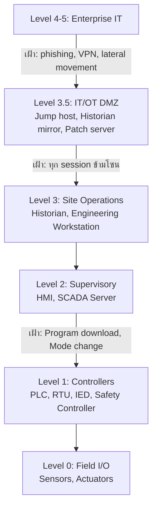

# ICS / OT Matrix — 12 Tactics + ICS Assets

## ภาพรวม

การโจมตีระบบควบคุมอุตสาหกรรมมีผลต่อ **ความปลอดภัยของคนและกระบวนการผลิตทางกายภาพ** ไม่ใช่แค่ข้อมูล หลักการตอบสนองจึงต่างจาก IT:

| IT | OT |
|---|---|
| Isolate เครื่องทันทีเมื่อสงสัย | **ห้าม** isolate/รีบูต controller หรือ HMI โดยไม่ประสานวิศวกรควบคุมกระบวนการ — อาจทำให้กระบวนการหยุดหรือไม่ปลอดภัย |
| ความลับของข้อมูลสำคัญที่สุด | **Safety และ Availability** สำคัญที่สุด |
| สแกนเครือข่ายเชิงรุกได้ | ใช้ **passive monitoring** — การสแกนเชิงรุกอาจทำให้ PLC รุ่นเก่าค้าง |
| แพตช์ได้ตามรอบ | แพตช์ได้เฉพาะช่วง shutdown ตามแผน → พึ่ง compensating control |

การโจมตี OT ส่วนใหญ่ **เริ่มจากเครือข่าย IT** (phishing → lateral movement → jump host/engineering workstation) ดังนั้น playbook ฝั่ง [Enterprise](../enterprise/) ใช้กับขั้นแรกๆ เสมอ

## Log และเครื่องมือที่ต้องมี

| แหล่งข้อมูล | ใช้ตรวจอะไร |
|---|---|
| OT network sensor (Microsoft Defender for IoT, Claroty, Nozomi, Dragos) | คำสั่ง Program Download/Upload, เปลี่ยนโหมด PLC, firmware update, อุปกรณ์ใหม่, การสแกน |
| `SecurityAlert` (Defender for IoT → Sentinel) | alert จาก sensor |
| Firewall ที่ IT/OT DMZ (`CommonSecurityLog`) | traffic โปรโตคอลอุตสาหกรรมที่ข้ามโซน |
| MDE บน Engineering Workstation / HMI (ถ้าติดตั้งได้) | process, USB, remote access |
| Jump host / remote access gateway | ใครเข้า OT เมื่อไร |
| Historian / alarm log | ค่ากระบวนการผิดปกติ, alarm ถูกปิด |

## Purdue Model และจุดที่ต้องเฝ้า



## KQL ที่ใช้ได้ทั้ง Domain

**โปรโตคอลอุตสาหกรรมจากต้นทางที่ไม่ใช่โซน OT**
```kql
let otSubnets = dynamic(["10.50.0.0/16", "10.60.0.0/16"]);        // ใส่ subnet ของโซน OT จริง
let otPorts = dynamic([502, 102, 20000, 44818, 2222, 4840, 47808, 1911, 789, 2404, 18245]);
// 502 Modbus, 102 S7comm, 20000 DNP3, 44818/2222 EtherNet/IP, 4840 OPC UA, 47808 BACnet,
// 1911 Niagara Fox, 789 Red Lion, 2404 IEC 60870-5-104, 18245 GE SRTP
CommonSecurityLog
| where TimeGenerated > ago(1d)
| where DestinationPort in (otPorts)
| where not(ipv4_is_in_any_range(SourceIP, otSubnets))
| summarize Sessions = count(), Ports = make_set(DestinationPort), Targets = make_set(DestinationIP, 20) by SourceIP, DeviceAction
```

**Alert จาก Defender for IoT**
```kql
SecurityAlert
| where TimeGenerated > ago(7d)
| where ProductName has "IoT"
| summarize Alerts = count(), Severities = make_set(AlertSeverity), Example = take_any(Description)
    by AlertName, CompromisedEntity
| order by Alerts desc
```

**Remote access เข้าโซน OT นอกช่วงที่อนุมัติ**
```kql
let otJumpHosts = dynamic(["OT-JUMP01", "OT-JUMP02"]);           // ใส่ชื่อ jump host จริง
DeviceLogonEvents
| where Timestamp > ago(7d)
| where DeviceName in~ (otJumpHosts) and ActionType == "LogonSuccess"
| where LogonType in ("RemoteInteractive", "Network")
| extend Hour = hourofday(Timestamp), Weekday = dayofweek(Timestamp)
| where Hour !between (7 .. 18) or Weekday in (0d, 6d)
| project Timestamp, DeviceName, AccountName, RemoteIP, LogonType
```

**USB บน Engineering Workstation / HMI**
```kql
let otHosts = dynamic(["EWS-01", "HMI-01"]);                     // ใส่ชื่อเครื่องจริง
DeviceEvents
| where Timestamp > ago(7d)
| where DeviceName in~ (otHosts)
| where ActionType in ("UsbDriveMounted", "PnpDeviceConnected")
| project Timestamp, DeviceName, ActionType, AdditionalFields
```

> **สิ่งที่ต้องปรับ** — ชื่อ alert ของ Defender for IoT และผลิตภัณฑ์อื่นต่างกันตามเวอร์ชัน ให้ map `AlertName` จริงในระบบของคุณเข้ากับแต่ละ Tactic ด้านล่าง

---

## TA0108 Initial Access

**วิธีทำงาน** — เข้าจาก IT ผ่านบริการรีโมต (T0822, T0886 — VPN ของ vendor, TeamViewer บน HMI), อุปกรณ์ที่เปิดสู่อินเทอร์เน็ตโดยตรง (T0883), USB/laptop ของผู้รับเหมา (T0847, T0864 Transient Cyber Asset), phishing ไปยังวิศวกร (T0865), supply chain (T0862), Wi-Fi ในโรงงาน (T0860)

**วิธีตรวจสอบ** — session ข้ามโซนที่ไม่ผ่าน jump host, อุปกรณ์ใหม่บนเครือข่าย OT (sensor alert), การเชื่อมต่อ OT ออกอินเทอร์เน็ต

**วิธีรับมือ** — ตัดช่องทางรีโมตที่ไม่ได้รับอนุญาตที่ firewall ของ DMZ (ไม่แตะ controller), ตรวจเครื่องที่ใช้เข้ามา, ประสานวิศวกรตรวจสถานะกระบวนการ

**ป้องกันระยะยาว** — remote access ผ่าน jump host ที่มี MFA และบันทึก session เท่านั้น, ตรวจ/สแกน USB ที่ kiosk ก่อนนำเข้า, ค้นหาอุปกรณ์ OT บน Shodan เป็นรอบ

## TA0104 Execution

**วิธีทำงาน** — แก้ controller tasking (T0821), เปลี่ยนโหมด PLC เป็น Program/Remote (T0858), ใช้ API ของซอฟต์แวร์ควบคุม (T0871), script บน EWS (T1701), GUI ของ HMI (T0823)

**วิธีตรวจสอบ** — sensor แจ้ง *mode change* / *program change*; ตรวจ keyswitch ของ PLC (ควรอยู่ RUN)

**วิธีรับมือ** — ยืนยันกับวิศวกรว่ามีงาน maintenance หรือไม่ → ถ้าไม่มี เปลี่ยนกลับ RUN mode จากหน้าเครื่อง, เทียบโปรแกรมกับ golden copy

## TA0110 Persistence

**วิธีทำงาน** — แก้โปรแกรมใน PLC (T0889), ติดเชื้อไฟล์โปรเจกต์ (T0873 เช่น Step7/TIA Portal — แพร่เมื่อวิศวกรเปิดไฟล์), แก้ firmware (T1693), ใช้ credential default/hardcoded (T1694), valid accounts (T0859)

**วิธีรับมือ** — เทียบ checksum ของโปรแกรม/firmware กับ golden image ที่เก็บแบบ offline, โหลดโปรแกรมที่ถูกต้องกลับในช่วงที่วิศวกรอนุมัติ, เปลี่ยน credential default

**ป้องกันระยะยาว** — เก็บ golden copy ของโปรแกรม PLC และ firmware พร้อม hash, change management สำหรับทุก program download

## TA0111 Privilege Escalation

**วิธีทำงาน** — exploit ช่องโหว่ของซอฟต์แวร์ ICS (T0890), hooking (T0874)

**วิธีรับมือ / ป้องกัน** — ถ้าแพตช์ไม่ได้ทันที ใช้ compensating control: จำกัดเครือข่าย, application allowlisting บน HMI/EWS

## TA0103 Evasion

**วิธีทำงาน** — ส่ง **reporting message ปลอม** ให้ HMI เห็นค่าปกติ (T1692.002), rootkit ในอุปกรณ์ (T0851), ปลอมชื่อไฟล์ (T0849), ลบร่องรอย (T0872), เปลี่ยนโหมด (T0858)

**วิธีตรวจสอบ** — เปรียบเทียบค่าจาก sensor อิสระ/ค่าภาคสนามกับค่าบน HMI; การตรวจค่าทางฟิสิกส์ที่ไม่สอดคล้องกัน (เช่น อัตราไหลไม่สัมพันธ์กับแรงดัน)

## TA0102 Discovery

**วิธีทำงาน** — remote system discovery ด้วย broadcast/multicast/port scan (T0846), sniffing (T0842), อ่านข้อมูลอุปกรณ์ (T0888), enumerate connection (T0840), wireless sniffing (T0887)

**วิธีตรวจสอบ** — sensor แจ้ง *scan* หรือ *unknown device*; ทุกการสแกนในโซน OT ที่ไม่ได้นัดหมายถือเป็นเหตุ

**วิธีรับมือ** — ระบุเครื่องที่สแกน (มักเป็น EWS หรือ jump host ที่ถูกยึด), ตัดการเชื่อมต่อเครื่องนั้นจากเครือข่าย OT หลังประสานวิศวกร

## TA0109 Lateral Movement

**วิธีทำงาน** — ใช้ remote services (T0886), credential default (T1694), ส่งเครื่องมือข้ามเครื่อง (T0867), **Program Download** ไปยัง PLC (T0843)

**วิธีตรวจสอบ** — program download จาก IP ที่ไม่ใช่ EWS ที่ได้รับอนุญาต (สัญญาณสำคัญที่สุดใน OT)

**วิธีรับมือ** — **Critical**: แจ้งหัวหน้ากะ/วิศวกรทันที, ตรวจสถานะกระบวนการ, block ต้นทางที่ firewall ระหว่างโซน, เทียบโปรแกรมใน PLC กับ golden copy

## TA0100 Collection

**วิธีทำงาน** — อ่าน I/O image (T0877), point & tag (T0861), program upload (T0845), ติดตามสถานะกระบวนการ (T0801), screen capture HMI (T0852), ข้อมูลจาก historian (T0811) — ใช้เตรียมการโจมตีที่มีผลทางกายภาพ

**วิธีตรวจสอบ** — program upload จากเครื่องที่ไม่ใช่ EWS, การ query historian จาก IT ปริมาณมากผิดปกติ

## TA0101 Command and Control

**วิธีทำงาน** — ใช้พอร์ตที่ใช้ทั่วไป (T0885), connection proxy (T0884), โปรโตคอลมาตรฐาน (T0869 รวม DNS)

**วิธีตรวจสอบ** — อุปกรณ์ในโซน OT ติดต่ออินเทอร์เน็ต (ไม่ควรเกิดเลย) → ใช้ firewall log ของ DMZ

## TA0107 Inhibit Response Function

**วิธีทำงาน** — ปิด alarm (T0878, T0838), เปิด firmware update mode ให้อุปกรณ์หยุดตอบสนอง (T0800), block command/reporting message (T1691), block การสื่อสาร (T1695), restart/shutdown อุปกรณ์ (T0816), DoS (T0814), เปลี่ยน credential ไม่ให้ผู้ดูแลเข้า (T0892), แก้/ลบข้อมูล (T0809), หยุด service (T0881)

**วิธีตรวจสอบ** — alarm ถูกปิดหรือแก้ setpoint ใน alarm config, safety controller เปลี่ยนสถานะ, อุปกรณ์หลุดการสื่อสาร

**วิธีรับมือ** — **Critical (เกี่ยวกับ Safety)**: เปิดใช้ขั้นตอน manual operation และ safety procedure ของโรงงาน, ประเมินว่าต้องหยุดกระบวนการอย่างปลอดภัยหรือไม่ (ตัดสินโดยผู้รับผิดชอบด้าน process safety)

**ป้องกันระยะยาว** — แยก Safety Instrumented System ออกจากเครือข่ายควบคุม, keyswitch ของ safety controller อยู่ RUN, physical interlock ที่ไม่พึ่งซอฟต์แวร์

## TA0106 Impair Process Control

**วิธีทำงาน** — แก้ parameter/setpoint (T0836), brute force I/O (T0806), unauthorized command message (T1692.001), แก้ firmware (T1693)

**วิธีตรวจสอบ** — คำสั่ง write ไปยัง register/tag สำคัญนอกช่วงเวลาปกติหรือจากต้นทางที่ไม่ใช่ HMI/SCADA ที่กำหนด, ค่า setpoint เกินช่วงที่ออกแบบ

**วิธีรับมือ** — คืนค่า parameter จากค่าที่ออกแบบ, ตรวจผลกระทบต่ออุปกรณ์, block ต้นทาง

## TA0105 Impact

**วิธีทำงาน** — ความเสียหายต่อทรัพย์สิน (T0879), สูญเสียการควบคุม/การมองเห็น/การป้องกัน/ความปลอดภัย (T0827, T0829, T0837, T0880), denial of view/control (T0815, T0813), สูญเสียผลผลิตและรายได้ (T0828) — รวมถึงผลจาก ransomware ฝั่ง IT ที่ทำให้ต้องหยุดโรงงานเพื่อความปลอดภัย

**วิธีรับมือ** — ดำเนินการตาม business continuity / emergency plan ของโรงงาน, กู้คืน HMI/EWS/historian จาก backup offline, ยืนยันความสมบูรณ์ของโปรแกรม PLC ก่อนเดินเครื่อง, รายงานหน่วยงานกำกับ (เช่น สกมช. สำหรับโครงสร้างพื้นฐานสำคัญทางสารสนเทศ)

---

## ICS Assets (A0001–A0018) และสิ่งที่ต้องปกป้อง

| ID | Asset | ความเสี่ยงหลัก | มาตรการสำคัญ |
|---|---|---|---|
| A0001 | Workstation (Engineering/Operator) | จุดที่ใช้ program download | ไม่มีอีเมล/เว็บ, allowlisting, MFA, USB control |
| A0002 | HMI | denial/manipulation of view | allowlisting, ไม่มี remote access โดยตรง |
| A0003 | PLC | modify program / parameter | keyswitch RUN, golden copy, program change alert |
| A0004 | RTU | unauthorized command | segmentation, protocol allowlist |
| A0005 | IED | ความผิดพลาดของระบบป้องกันไฟฟ้า | config baseline, IEC 61850 monitoring |
| A0006 | Data Historian | ทางเชื่อม IT/OT | mirror ใน DMZ, IT อ่านจาก mirror เท่านั้น |
| A0007 | Control Server | สั่งการ RTU/PLC ทั้งหมด | hardening, MFA, monitoring |
| A0008 | Application Server | ซอฟต์แวร์สนับสนุนที่มีช่องโหว่ | แพตช์ตามรอบ shutdown, segmentation |
| A0009 | Data Gateway | แปลงโปรโตคอลข้ามโซน | จำกัด direction ของข้อมูล |
| A0010 | Safety Controller | loss of safety | แยกเครือข่าย, keyswitch, ห้ามรีโมต |
| A0011 | VPN Server | ช่องทางเข้าของ vendor | MFA, เปิดเฉพาะเมื่ออนุมัติ, บันทึก session |
| A0012 | Jump Host | ทางผ่านเดียวจาก IT สู่ OT | MFA, session recording, EDR |
| A0013 | Field I/O | ข้อมูลภาคสนามถูกปลอม | ตรวจความสอดคล้องทางฟิสิกส์ |
| A0014 | Routers | bridging โซน | config backup, ACL |
| A0015 | Switch | mirror/sniffing | port security, ปิดพอร์ตที่ไม่ใช้ |
| A0016 | Firewall | ขอบเขต IT/OT | default deny, review rule รายไตรมาส |
| A0017 | DCS Controller | modify control logic | change management, golden copy |
| A0018 | PAC | เหมือน PLC + attack surface ของ PC | hardening ทั้งสองด้าน |

---

## Checklist ตอบสนองเหตุ OT

- [ ] แจ้งหัวหน้ากะและวิศวกรควบคุมกระบวนการ **ก่อน** ดำเนินการใดๆ กับอุปกรณ์ในโซน OT
- [ ] ประเมิน safety: กระบวนการยังอยู่ในสภาวะปลอดภัยหรือไม่ ต้องเปลี่ยนเป็น manual หรือหยุดอย่างปลอดภัยหรือไม่
- [ ] Contain ที่ขอบเขตเครือข่าย (firewall ของ DMZ, ตัด remote access) แทนการ isolate อุปกรณ์ควบคุม
- [ ] เก็บหลักฐาน: packet capture จาก sensor, log ของ jump host/EWS, โปรแกรม PLC ปัจจุบัน
- [ ] เทียบโปรแกรม/firmware/config กับ golden copy ก่อนคืนสู่การทำงานปกติ
- [ ] ตรวจฝั่ง IT ว่าผู้โจมตีเข้ามาทางไหน (มักเริ่มจาก Enterprise)
- [ ] รายงานหน่วยงานกำกับตามกฎหมายและระเบียบของอุตสาหกรรม
